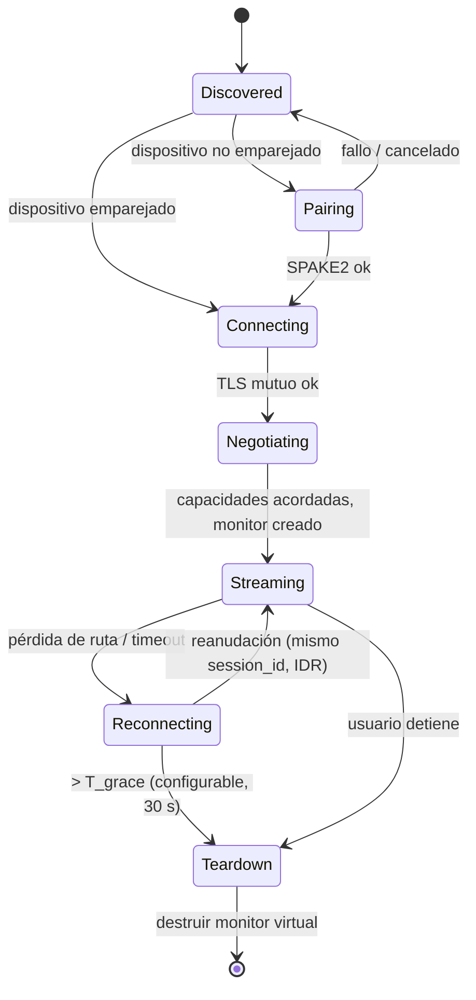

# 2. Arquitectura técnica propuesta

## 2.1 Requisitos que guían las decisiones

| Requisito | Objetivo medible |
|---|---|
| Latencia *glass-to-glass* (de píxel en la fuente a fotón en el receptor) | ≤ 35 ms p95 a 1080p60 por Ethernet; ≤ 60 ms p95 por Wi-Fi 5/6 |
| Calidad | Texto legible a 1080p60 con 15–25 Mbps; hasta 4K60 con 40–80 Mbps por cable |
| Uso de CPU | < 10 % de un núcleo en la fuente con la ruta de hardware (*zero-copy*) |
| Seguridad | Todo el tráfico cifrado y autenticado; emparejamiento resistente a ataques offline |
| Robustez | Reconexión transparente en menos de 2 s ante cortes de hasta 10 s |
| Portabilidad | Windows 10 21H2+ y 11; Linux con GNOME 46+, KDE Plasma 6+, Sway/Hyprland y X11 (mediante EVDI) |

## 2.2 Decisiones estructurales

### D1. Receptor nativo, no navegador
Tres de las cinco referencias usan un navegador como receptor (Deskreen, Weylus, ScreenExtend). Esto impone:
- el *jitter buffer* de WebRTC o MSE;
- ningún control sobre el decodificador;
- un dibujado sincronizado con el compositor del navegador.

Como los dos extremos son PCs donde instalamos CrossScreen, **el receptor es un proceso nativo**: decodifica por hardware (D3D11VA/MF en Windows, VAAPI en Linux) y dibuja con `wgpu` en una ventana a pantalla completa sin bordes. Un receptor web (tablets) queda como extensión futura y opcional. → [ADR-0003](adr/0003-receptor-nativo.md)

### D2. Tres procesos separados
```
┌────────────────────┐  IPC local autenticada   ┌───────────────────────┐
│  crossscreen-ui    │◄───────────────────────►│  crossscreen-agent    │
│  (Tauri + React)   │  (named pipe / UDS)      │  (daemon de usuario)  │
└────────────────────┘                          │  sesiones, pipeline,  │
                                                │  transporte, seguridad│
┌────────────────────┐  memoria compartida /    └──────────┬────────────┘
│ crossscreen-viewer │  canal interno                      │ IPC
│ (winit + wgpu)     │◄────────────────────────────────────┤
└────────────────────┘                          ┌──────────▼────────────┐
                                                │ helper privilegiado   │
                                                │ (opcional, mínimo):   │
                                                │ instalar driver, EVDI │
                                                └───────────────────────┘
```
- **Agente** (`crossscreen-agent`). Proceso de larga duración en la sesión del usuario. Contiene el núcleo (sesiones, captura, codificación, transporte).
  - El *streaming* sigue aunque se cierre la interfaz.
  - Si la interfaz falla, no tumba la sesión.
- **Interfaz** (`crossscreen-ui`). Tauri es el panel de control (descubrimiento, emparejamiento, configuración, estadísticas). **No lleva vídeo.**
  - WebView2 y WebKitGTK no pueden mostrar texturas decodificadas por hardware sin copiar.
  - WebKitGTK tampoco garantiza WebCodecs.
- **Visor** (`crossscreen-viewer`). Ventana nativa que decodifica y presenta. Es un proceso aparte para aislar los fallos de los drivers de GPU. Si el arranque lo requiere, puede convivir en el mismo proceso que el agente.
- **Helper privilegiado.** Existe solo para operaciones que lo exigen (instalar o activar el driver IddCx, cargar EVDI). Expone una API mínima con argumentos validados y se ejecuta bajo demanda, **nunca como servicio permanente con privilegios**. Esto corrige los problemas observados en TwinDesk (polkit sin contraseña) y ScreenExtend (certificado raíz autofirmado).

### D3. Núcleo independiente del SO; plataformas detrás de *traits*
Todo lo que depende del SO se expresa con pocas interfaces estrechas. El núcleo no conoce `windows` ni `pipewire`.

```rust
// Ilustrativo: firmas conceptuales, no código de implementación.
trait VirtualDisplayProvider {
    fn capabilities(&self) -> DisplayCaps;                 // modos, HDR, máx. monitores
    fn create(&self, spec: &DisplaySpec) -> Result<VirtualDisplayHandle>;
    fn reconfigure(&self, h: &VirtualDisplayHandle, mode: Mode) -> Result<()>;
    fn destroy(&self, h: VirtualDisplayHandle) -> Result<()>;
}
trait CaptureSource { fn next_frame(&mut self, deadline: Instant) -> Result<CapturedFrame>; }
trait VideoEncoder  { fn encode(&mut self, f: &CapturedFrame, ctl: &EncodeControl) -> Result<EncodedUnit>; }
trait VideoDecoder  { fn decode(&mut self, u: &EncodedUnit) -> Result<DecodedFrame>; }
trait InputInjector { fn inject(&mut self, ev: &InputEvent) -> Result<()>; }
```

- `CapturedFrame` y `DecodedFrame` son *handles* a memoria de GPU (textura D3D11, DMA-BUF) o CPU. La ruta *zero-copy* se negocia por capacidades, no por `cfg` dispersos.
- **No se crean abstracciones especulativas.** Audio, portapapeles y archivos tendrán sus *traits* cuando se implementen, no antes.

## 2.3 Diagrama de componentes

```mermaid
flowchart LR
  subgraph SRC["Equipo FUENTE"]
    direction TB
    UI1["crossscreen-ui<br/>Tauri + React"]
    subgraph AG1["crossscreen-agent"]
      SES1["Sesiones<br/>cs-session"]
      SEC1["Seguridad<br/>cs-security"]
      DISC1["Descubrimiento<br/>cs-discovery (mDNS)"]
      VD["Monitor virtual<br/>cs-display"]
      CAP["Captura<br/>cs-capture"]
      ENC["Codificación<br/>cs-encode"]
      INJ["Inyección de entrada<br/>cs-input"]
      TR1["Transporte<br/>cs-transport (QUIC)"]
    end
    DRV["Driver IddCx (Win)<br/>Mutter / KWin / wlroots / EVDI (Linux)"]
    HELP1["Helper privilegiado"]
  end

  subgraph SNK["Equipo RECEPTOR"]
    direction TB
    UI2["crossscreen-ui"]
    subgraph AG2["crossscreen-agent"]
      SES2["Sesiones"]
      SEC2["Seguridad"]
      DISC2["Descubrimiento"]
      TR2["Transporte"]
      CAPIN["Captura de entrada local<br/>cs-input"]
    end
    VW["crossscreen-viewer<br/>cs-decode + cs-render (wgpu)"]
  end

  UI1 <-->|IPC local| SES1
  UI2 <-->|IPC local| SES2
  SES1 --> VD --> DRV
  HELP1 -.instala / activa.-> DRV
  DRV -->|frames| CAP --> ENC --> TR1
  TR1 <==>|"QUIC: datagramas de vídeo cifrados<br/>streams fiables de control y entrada"| TR2
  TR2 --> VW
  CAPIN --> TR2
  TR1 --> INJ
  SEC1 --- TR1
  SEC2 --- TR2
  DISC1 <-.mDNS _crossscreen._udp.-> DISC2
```

## 2.4 Flujo de datos de un frame (modo extender, fuente Windows)

| # | Etapa | Componente | Tecnología | Presupuesto p95 |
|---|---|---|---|---|
| 1 | El escritorio pinta en el monitor virtual | Driver IddCx (VDD) | IddCx / DWM | — |
| 2 | Captura del monitor virtual | `cs-capture` | DXGI Desktop Duplication, textura D3D11 (WGC como *fallback*) | 2 ms |
| 3 | Conversión de color BGRA → NV12 en GPU | `cs-encode` | Video Processor de D3D11 / *shader* de cómputo | 1 ms |
| 4 | Codificación H.264 de baja latencia | `cs-encode` | MF HW MFT o NVENC/AMF/QSV directo, sin frames B, CBR, VBV de ~1 frame | 5 ms |
| 5 | Empaquetado, FEC y cifrado | `cs-transport` | Fragmentación en datagramas QUIC ≤ 1200 B, FEC Reed-Solomon, TLS 1.3 (AES-GCM) | 1 ms |
| 6 | Red | — | Ethernet 1 Gb (Wi-Fi: 3–15 ms) | 1–2 ms |
| 7 | Reensamblado y FEC | `cs-transport` | — | 1 ms |
| 8 | Decodificación por hardware | `cs-decode` | D3D11VA / MF (Windows), VAAPI (Linux) | 4 ms |
| 9 | Presentación | `cs-render` | `wgpu`, *swapchain* en modo mailbox o *immediate* | ≤ 1 *vsync* (8 ms de media a 60 Hz) |
| | **Total** | | | **≈ 25 ms** (margen frente al objetivo de 35 ms) |

**Cursor fuera de banda.** La forma del cursor (cuando cambia) y su posición (a 120–240 Hz) se envían por un canal aparte, y el visor lo dibuja como capa encima del vídeo. Así el puntero responde con la latencia de la red y no con la del pipeline de vídeo. Sunshine compone el cursor dentro del vídeo, y por eso el puntero sufre toda la latencia del vídeo.

## 2.5 Capas y responsabilidades

| Capa | Crates | Responsabilidad | Depende de |
|---|---|---|---|
| Dominio | `cs-core` | Tipos (`DeviceId`, `DisplaySpec`, `Mode`), errores, configuración, reloj | nada |
| Protocolo | `cs-protocol` | Mensajes de control versionados, cabecera de vídeo binaria y su serialización | `cs-core` |
| Seguridad | `cs-security` | Identidad del dispositivo, emparejamiento (SPAKE2), almacén de confianza, verificador TLS con certificado fijado | `cs-core` |
| Transporte | `cs-transport` | QUIC (quinn), fragmentación, FEC, *pacing*, estadísticas, control de tasa | `cs-protocol`, `cs-security` |
| Descubrimiento | `cs-discovery` | Anuncio y búsqueda mDNS, entrada manual de IP | `cs-core` |
| Sesión | `cs-session` | Máquina de estados de la sesión, reconexión, negociación de capacidades, orquestación del pipeline | todas las anteriores y los *traits* de plataforma |
| Plataforma | `cs-display`, `cs-capture`, `cs-encode`, `cs-decode`, `cs-render`, `cs-input` | Implementaciones por SO detrás de los *traits* | `cs-core` |
| Aplicaciones | `crossscreen-agent`, `crossscreen-viewer`, `apps/desktop` | Ensamblado, IPC y UI | todo |

## 2.6 Seguridad (resumen; detalle en [ADR-0004](adr/0004-seguridad-emparejamiento.md))

1. **Identidad.** Cada instalación genera un par de claves Ed25519 y un certificado X.509 autofirmado que lo envuelve. La clave privada se guarda en el almacén del SO: DPAPI en Windows, Secret Service / `keyutils` en Linux (con *fallback* a un archivo `0600`).
2. **Emparejamiento (una vez por pareja de dispositivos).**
   1. El receptor muestra un código de 6 dígitos.
   2. La fuente lo introduce.
   3. Ambos ejecutan **SPAKE2**, un PAKE (intercambio de claves autenticado por contraseña): un observador pasivo no puede probar PINs offline, y uno activo solo dispone de un intento por sesión.
   4. Con la clave PAKE se autentica el intercambio de las huellas de los certificados.
   5. Ambos guardan la huella del otro. Hay límite de intentos y bloqueo exponencial.
3. **Conexiones posteriores.** QUIC/TLS 1.3 con **autenticación mutua y certificados fijados** (verificador personalizado en rustls). No hay CA ni confianza en el primer uso sin emparejar.
4. **Todo cifrado.** Vídeo, audio, control y entrada viajan dentro de la misma conexión QUIC. No existe "LAN sin cifrar" (la política por defecto de Sunshine).
5. **IPC local.** Named pipe con DACL limitada al usuario en Windows; socket Unix `0700` con verificación de `SO_PEERCRED` en Linux.
6. **mDNS sin secretos.** Los registros TXT solo llevan id público, nombre, versión del protocolo y roles admitidos.

## 2.7 Gestión de sesiones y reconexión



- **Durante `Reconnecting` el monitor virtual se mantiene** hasta `T_grace`, para que Windows o el compositor no reorganicen las ventanas con cada microcorte de Wi-Fi.
- QUIC admite **migración de conexión**: si el receptor cambia de IP (de Wi-Fi a Ethernet), la conexión sobrevive sin renegociar.
- Al reanudar, el receptor pide un IDR. Si hay pérdidas, se usa invalidación de referencias cuando el codificador la soporta (NVENC) o un IDR en caso contrario.

## 2.8 Control de tasa adaptativo

- **Señales:** el receptor informa cada 100 ms de las pérdidas antes y después del FEC, el *jitter* entre llegadas y el tiempo de decodificación. La fuente añade el RTT de QUIC.
- **Algoritmo inicial:** AIMD sobre el bitrate objetivo del codificador. Se reduce un 15 % si hay pérdidas tras el FEC o si el retardo crece de forma sostenida (*delay gradient*, al estilo de GCC), y se sube un 5 % por segundo estable.
- **Porcentaje de FEC:** se adapta a la pérdida medida antes del FEC (10 % de partida; 0–50 %).
- **Control de congestión:** el de QUIC se configura para no pelear con el control de la aplicación. Esto se mide en la PoC-4 (ver [08-pruebas-de-concepto.md](08-pruebas-de-concepto.md)).

## 2.9 Modos de operación

| Modo | Fuente | Receptor | Entrada |
|---|---|---|---|
| **Extender** | Crea un monitor virtual y captura ese monitor | Presenta a pantalla completa | No hace falta: el ratón de la fuente "cruza" al monitor virtual de forma nativa |
| **Duplicar** | Captura un monitor existente (sin driver) | Presenta, escalado | Opcional |
| **Control remoto / KVM** (futuro) | Igual que duplicar | Igual que duplicar | El teclado y el ratón del receptor se envían a la fuente |

**Duplicar no necesita driver.** Por eso es la primera funcionalidad del MVP: valida captura, codificación, transporte, decodificación y presentación sin depender del riesgo del monitor virtual.
