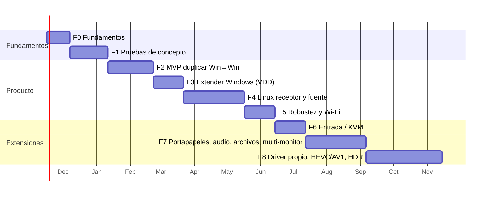

# 7. Roadmap de implementación por fases

Cada fase tiene **criterios de salida medibles**. No se empieza la siguiente fase hasta cumplirlos. Las duraciones suponen 1–2 desarrolladores a tiempo completo y son orientativas.

---

## Estado a 2026-11-09 (`v0.0.7-alpha.39`)

Leyenda: ✅ cumplido · 🟡 en parte · ❌ pendiente. Detalle y bitácora en [ESTADO.md](ESTADO.md).

| Fase | Hecho | Falta para cumplir la salida |
|---|---|---|
| **F0** Fundamentos | ✅ CI en Windows y Linux, release automática, `cargo-deny`, licencias, ADR | `cs-testkit`/`netsim` completo (hay inyector Gilbert-Elliott en `cs-transport`) y *fuzzing* con `cargo-fuzz` |
| **F1** PoC | ✅ PoC-1 a 5, 7 (Mutter), 8 (Mutter/portal), 9, 10, 11 | **PoC-6**: medición *glass-to-glass* con cámara; PoC-3/5 en Linux con VAAPI; PoC-7 en KDE y Sway |
| **F2** MVP Windows → Windows | ✅ cadena completa entre dos PCs por Wi-Fi, emparejamiento, mDNS, cursor, panel con estadísticas, reconexión, tests de seguridad negativos | **Medir** 1080p60 durante 2 h y p95 *glass-to-glass* ≤ 40 ms **por cable** |
| **F3** Extender en Windows | ✅ VDD + CCD, resolución del receptor, retirada limpia, ventana de gracia | Prueba de suspensión/reanudación y de *kill* del agente con el monitor activo |
| **F4** Linux | ✅ receptor (OpenH264 + wgpu, Wayland/X11); fuente duplicar (portal + PipeWire) y extender (monitor virtual de Mutter) en GNOME; entrada y portapapeles; reconexión | **VAAPI** (decodificar y codificar por GPU); `restore_token` (no pedir el diálogo cada vez); respaldo X11/XShm; **KDE Plasma 6 y Sway**; **probar Linux → Linux** |
| **F5** Robustez y Wi-Fi | ✅ FEC adaptativo y entrelazado, perfiles de red, ventana de gracia, 0 congelaciones con ~5 % de pérdida en ráfagas (Gilbert-Elliott) | Control de tasa adaptativo (el codificador MF de Intel ignora el cambio de bitrate en caliente); migración de interfaz; medir p95 ≤ 60 ms en Wi-Fi 6 |
| **F6** Entrada remota | ✅ ratón y teclado en las tres direcciones (SendInput; Mutter `RemoteDesktop`/portal en Linux), liberación de teclas al cortar | Táctil y pluma; **medir** latencia de ratón ≤ 1 RTT + 2 ms y 10 000 eventos sin pérdidas |
| **F7** Valor añadido | ✅ portapapeles de **texto** bidireccional, perfiles de red; arranque automático, registros, OpenH264 desde el panel; **audio** (Opus, ADR-0008); **varios monitores** por sesión (ADR-0009); **transferencia de archivos** (ADR-0010) | Portapapeles de **imágenes** |
| **F8** Avanzado | — | Driver IddCx propio, HEVC/AV1, HDR, receptor web |

Para 1.0, además: auditoría de seguridad externa, firma de código e instalador de Windows (con regla de firewall).

### F0: Fundamentos (≈ 3 semanas)
- Repositorio con la estructura de [05-estructura-monorepo.md](05-estructura-monorepo.md), CI y `cargo-deny`.
- Verificar las licencias upstream: VDD, virtual-display-rs, windows-capture y los crates de la tabla de dependencias.
- `cs-core` y `cs-protocol` con tests de *round-trip* y *fuzzing* básico.
- `cs-testkit` con una fuente sintética y `netsim`.
- **Salida:**
  - CI en verde en Windows y Linux;
  - ADR-0001 a ADR-0005 aprobados;
  - licencias verificadas y documentadas.

### F1: Pruebas de concepto (≈ 5 semanas)
- Ejecutar las PoC de [08-pruebas-de-concepto.md](08-pruebas-de-concepto.md). Son código desechable en `tools/poc/`.
- **Salida:**
  - las PoC críticas (1, 3, 4, 5, 6, 7) con resultados documentados;
  - decisiones confirmadas o revisadas en los ADR;
  - el presupuesto de latencia de §2.4 contrastado con mediciones reales.

### F2: MVP "duplicar" Windows → Windows por cable (≈ 6 semanas)
- Captura DXGI DD de un monitor existente → codificación MF HW → QUIC con FEC → decodificación D3D11VA → visor `wgpu`.
- Emparejamiento SPAKE2, certificados fijados y descubrimiento mDNS.
- Cursor fuera de banda.
- UI Tauri mínima: lista de equipos, emparejar, conectar, estadísticas **reales**.
- **Salida:**
  - 1080p60 estable durante 2 h;
  - p95 glass-to-glass ≤ 40 ms por Ethernet;
  - reconexión tras un corte de cable de 5 s;
  - tests de seguridad negativos en verde.

### F3: Extender en Windows con monitor virtual (≈ 4 semanas)
- Backend `cs-display::windows::vdd`, instalación verificada a través del helper.
- Topología CCD y restauración al terminar.
- Selección de resolución y frecuencia según el receptor.
- **Salida:**
  - el monitor aparece en Configuración, se pueden arrastrar ventanas a él y desaparece limpiamente;
  - sobrevive a la suspensión y la reanudación;
  - el driver no queda en un estado inconsistente tras matar el agente (prueba de *kill*).

### F4: Linux (≈ 8 semanas)
- **F4a, receptor Linux** (Windows → Linux): decodificación VAAPI con OpenH264 de respaldo, visor `wgpu` en Wayland y X11.
- **F4b, fuente Linux en duplicar:** portal y PipeWire con `restore_token` en GNOME Wayland; X11 con XShm como respaldo.
- **F4c, fuente Linux en extender:** backends `mutter-virtual`, `kwin-virtual` y `wlroots-headless`, y luego `evdi`. Codificación VAAPI.
- **Salida:** las cuatro combinaciones (W→W, W→L, L→W, L→L) en duplicar y en extender, en GNOME 46+, Plasma 6 y Sway, con los mismos umbrales que F2.

### F5: Robustez, Wi-Fi y sesiones (≈ 4 semanas)
- Control de tasa adaptativo y FEC adaptativo, perfiles de conexión (cable, Wi-Fi, ahorro).
- Migración de interfaz.
- Ventana de gracia para conservar el monitor.
- Telemetría local de latencia, FPS, bitrate y pérdidas.
- **Salida:**
  - p95 ≤ 60 ms en Wi-Fi 6 a 5 m del AP;
  - sin congelaciones de más de 1 s con un 5 % de pérdida en `netsim`.

### F6: Entrada remota y KVM (≈ 4 semanas)
- Captura de entrada local en el visor; inyección con SendInput y libei, uinput y XTest de respaldo.
- Táctil y pluma.
- **Salida:** latencia de ratón ≤ 1 RTT + 2 ms; ningún evento perdido ni repetido en 10 000 eventos.

### F7: Funcionalidades de valor añadido (≈ 8 semanas)
- Portapapeles bidireccional (texto e imágenes).
- Audio Opus (WASAPI loopback / PipeWire).
- Transferencia de archivos por streams QUIC.
- Varios monitores virtuales por sesión.
- Perfiles.
- **Salida:** cada funcionalidad con tests de integración y aparece en la UI solo cuando está completa.

### F8: Avanzado (≈ 10 semanas)
- Driver IddCx propio (atestación de Microsoft, acceso a la *swap chain*, selección de adaptador).
- HEVC y AV1.
- HDR.
- Receptor web opcional (WebTransport + WebCodecs).
- **Salida:** según el ADR correspondiente en el momento.

---

## Hitos de publicación

| Versión | Contenido | Estado público |
|---|---|---|
| 0.1 | F2 | Alfa privada |
| 0.2 | F3 | Alfa pública solo para Windows |
| 0.3 | F4 | Beta multiplataforma |
| 0.5 | F5 + F6 | Beta |
| 1.0 | F7, auditoría de seguridad externa, firma de código | Estable |
